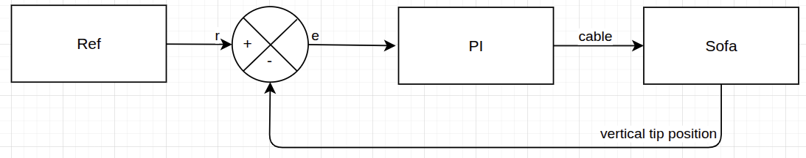
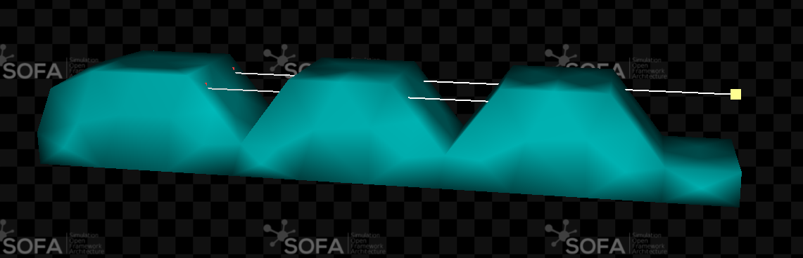
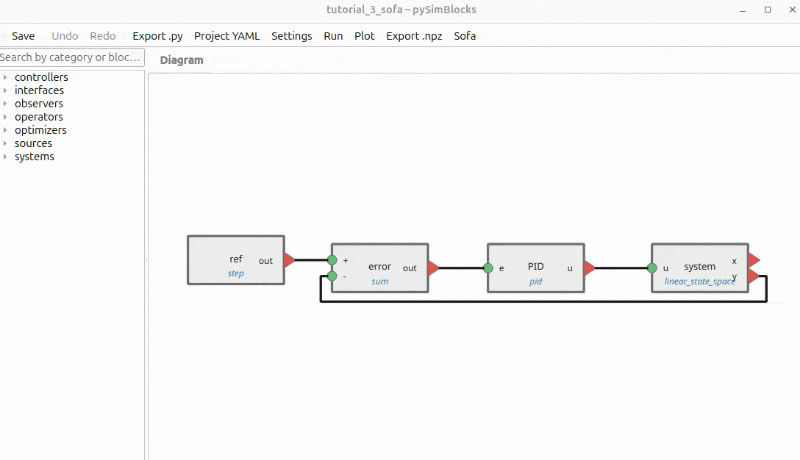
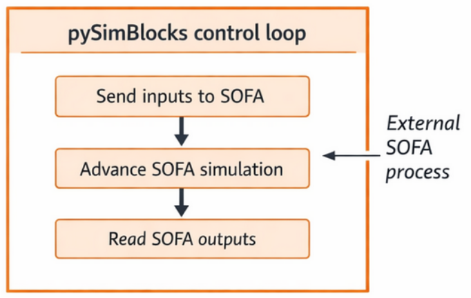
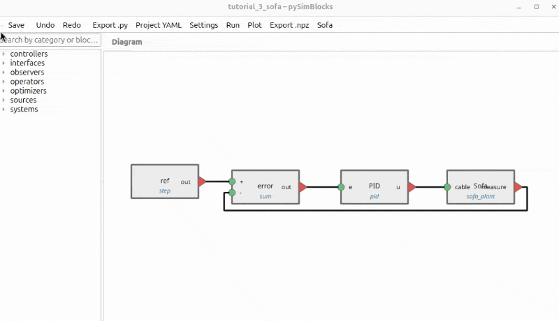
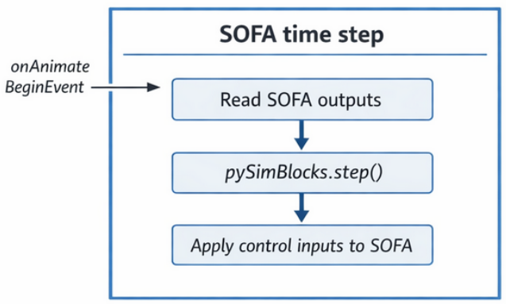
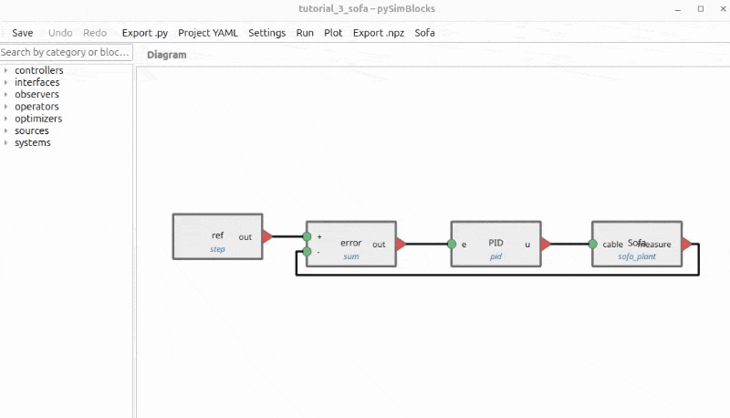
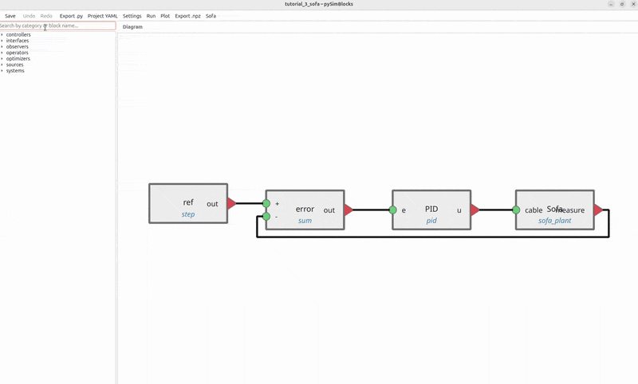

# Tutorial 3: Coupling pySimBlocks with SOFA

This tutorial builds on [Tutorial 1](./tutorial_1_python.md) and
[Tutorial 2](./tutorial_2_gui.md). The linear plant is replaced with a SOFA
scene so the controller interacts with a physics-based simulation.

## Goals

The objective is to:

- Configure the environment needed to run SOFA from `pySimBlocks`
- Replace the plant with a `SofaPlant` block
- Create a SOFA controller that exchanges signals with the block diagram
- Run the coupled model in both execution modes

By the end of this tutorial, you will be able to connect a `pySimBlocks`
control loop to a SOFA simulation.

## Required Files

This tutorial uses a SOFA scene and mesh files that are provided for you.
Download the archive below — it contains everything you need:

- `finger/Finger.py` — the SOFA scene
- `finger/mesh/` — mesh assets required by the scene
- `finger/FingerController.py` — the SOFA controller (also shown in full below)
- `project.yaml` — the Tutorial 2 project, as a starting point
- `project_solution.yaml` — the completed reference to compare against

{download}`Download tutorial_3_sofa.zip <../../_static/downloads/tutorial_3_sofa.zip>`

If you have cloned the repository, the files are already in
`examples/tutorials/tutorial_3_sofa/`.

Extract the archive so that `finger/` and `project.yaml` sit in the same
folder.

## System Description

We build the same closed-loop structure as in the previous tutorials:

- A constant reference
- A PI controller
- A SOFA simulation of a tendon-driven finger



The control input is the cable actuation, and the measured output is the
vertical fingertip position. The scene is expressed in millimetres, so the
reference and the slider bounds below are in millimetres too.



## Prerequisites

Before coupling `pySimBlocks` with SOFA, make sure:

- SOFA is installed
- Python can import `Sofa`
- The `SoftRobots` plugin is available (used by the finger scene)
- `pySimBlocks` is installed in the Python environment used by SOFA
- `runSofa` is available through `SOFA_ROOT`

`pySimBlocks` has been tested with SOFA `v24.06` and later.

### Linux and macOS

```bash
export SOFA_ROOT=/path/to/your/sofa

# Binary release:
export PYTHONPATH=$SOFA_ROOT/plugins/SofaPython3/lib/python3/site-packages:$PYTHONPATH

# Built from source:
# export PYTHONPATH=$SOFA_ROOT/lib/python3/site-packages:$PYTHONPATH
```

### Windows

```powershell
$env:SOFA_ROOT = "C:\path\to\your\sofa"

# Binary release:
$env:PYTHONPATH = "$env:SOFA_ROOT\plugins\SofaPython3\lib\python3\site-packages;$env:PYTHONPATH"

# Built from source:
# $env:PYTHONPATH = "$env:SOFA_ROOT\lib\python3\site-packages;$env:PYTHONPATH"
```

### Verify the Setup

Check that Python can import SOFA and `pySimBlocks`:

```python
import Sofa
import SofaRuntime
import pySimBlocks
```

Then verify that `runSofa` is available:

- Linux and macOS: `$SOFA_ROOT/bin/runSofa`
- Windows: `$env:SOFA_ROOT\bin\runSofa.exe`

If you use the GUI, launch it from a shell where `SOFA_ROOT` is defined: the
GUI looks for `runSofa` in `SOFA_ROOT/bin`, then in your `PATH`.


## SOFA Controller Contract

To exchange data between the diagram and the SOFA scene, subclass
`SofaPysimBlocksController` from `pySimBlocks.blocks.systems.sofa`.

Your controller must:

- accept a `project_yaml` argument and pass it to `super().__init__()`
- define `self.inputs` — dict of signals received from pySimBlocks
- define `self.outputs` — dict of signals sent back to pySimBlocks

It must implement:

- `set_inputs()` — apply `self.inputs` values to the SOFA scene
- `get_outputs()` — read SOFA state and write results into `self.outputs`

A few rules to keep in mind:

- The `input_keys` and `output_keys` of the block must be a **subset** of the
  keys declared in the controller. The controller can expose more signals than
  the diagram uses (`tip` in the example below).
- Outputs must be column vectors of shape `(n, 1)`, with the same shape at
  every call.
- Inputs are received as arrays too: a scalar arrives with shape `(1, 1)`.

Optionally, you can override `prepare_scene()` to wait for a condition before
the control loop starts (warm-up, stabilization…) and set `self.IS_READY = True`
when the scene is ready. Setting `self.verbose = True` prints the logged signals
at each control step.

### Example Controller

The tutorial example uses the following controller:
```{literalinclude} ../../../../examples/tutorials/tutorial_3_sofa/finger/FingerController.py
:language: python
:caption: examples/tutorials/tutorial_3_sofa/finger/FingerController.py
```

The scene must instantiate that controller, **forward the `--project-yaml`
command-line argument to it**, and return it from `createScene(...)` alongside
the root node. In `Finger.py`:

```python
parser = argparse.ArgumentParser(prog=sys.argv[0])
parser.add_argument("--project-yaml", type=str, default=None, dest="project_yaml")
args, _ = parser.parse_known_args()

# ... scene setup ...

controller = FingerController(
    cable.aCableActuator, finger.tetras,
    project_yaml=args.project_yaml,
)
finger.addObject(controller)

return rootNode, controller
```

When the GUI launches SOFA, it passes the path of your project through this
argument. If the scene does not forward it, the GUI reports a
*Project YAML mismatch*.

```{tip}
To start a new scene from scratch, `pysimblocks sofa-init <name>` generates a
scene and a controller template that already contain this plumbing.
```

## Configure the SofaPlant Block

Open `project.yaml` (the Tutorial 2 project) in the GUI. Only the plant changes,
but a few things that refer to it have to follow.

First, make sure the project directory is set in the Settings dialog: relative
paths such as `finger/Finger.py` are resolved against it.

Then replace the `LinearStateSpace` block from the previous tutorials with a
`SofaPlant` block from the Systems category, and name it `Sofa`.



Set the block parameters as follows (set the keys first: the ports of the block
are created from them):

| Parameter | Value |
| --- | --- |
| `scene_file` | `finger/Finger.py` |
| `input_keys` | `["cable"]` |
| `output_keys` | `["measure"]` |

The key names must match the dictionaries declared in the SOFA controller.

Finally, log and plot `ref.outputs.out` and `Sofa.outputs.measure` instead of the
  signals of the old plant.

> **Note:** Time step constraint  
> The SOFA scene dt (set in `createScene` via `rootNode.dt`) must be a positive
> integer divisor of the simulation time step. pySimBlocks checks this at
> startup and raises an error otherwise.
>
> - **pySimBlocks as master**: the time step is the `sample_time` of the
>   `SofaPlant` block, or the global simulation dt if it is empty.
> - **SOFA as master**: the time step is the global simulation dt. Leave
>   `sample_time` empty on the block.
>
> Example: if `rootNode.dt = 0.01` in your scene, valid time steps are 0.01,
> 0.02, 0.05, etc.


## Execution Modes

### pySimBlocks as Master

In this mode, `pySimBlocks` drives the clock. The `SofaPlant` block runs SOFA
headlessly, in a separate process, and advances it by one step at each control
iteration.



Run the model as you would in [Tutorial 2](./tutorial_2_gui.md), either from
the GUI or from the exported Python runner.



```{note}
The exported `run.py` wraps its entry point in `if __name__ == "__main__":`.
Keep this guard if you write your own runner: on Windows and macOS, the SOFA
process is started with `spawn`, which re-imports the main script.
```

### SOFA as Master

In this mode, SOFA drives the clock and the controller triggers the
`pySimBlocks` diagram during the SOFA animation loop. You do not need to change
the diagram: the controller automatically replaces the `SofaPlant` block with a
`SofaExchangeIO` block. The diagram must contain exactly one SOFA block.



Open the SOFA panel from the toolbar. It lets you check the path of `runSofa`,
choose the SOFA GUI (`imgui`, `qglviewer`, `qt` or `custom`), and launch the
scene with the `runSofa` button.



A log window streams the output of SOFA while it runs. Close the SOFA window to
end the simulation: the logs are then loaded back into the GUI, so you can plot
them as usual.

If something goes wrong, the log window reports the cause: `SOFA_ROOT` not
defined, `runSofa` not found, a `[pySimBlocks] ERROR` (wrong keys, incompatible
time step…), or a project YAML mismatch.

## Live Sliders and Plots

Live sliders and plots are only available with the
[Compliance Robotics GUI](https://github.com/SofaComplianceRobotics/SofaGLFW/tree/robotics)
(`robotics` branch of SofaGLFW). They require:

- SOFA as the master,
- the `imgui` GUI selected in the SOFA panel,
- a SOFA installation that includes the Compliance Robotics GUI.

Without these conditions the simulation still runs normally, but the sliders are
ignored and the plots are only available after the run.

Since the reference will be tuned live, it is more convenient to use a constant
than a step. Replace the Step block with a Constant block named ref (value 1.0).

### Configure the Sliders

In the dialog of the `SofaPlant` block, click **Configure sliders…**. A table
lists the numeric parameters of every block in the diagram. Tick the ones you
want to tune and set a min and a max for each:

| Parameter | Min | Max |
| --- | --- | --- |
| `ref.value` | -10.0 | 50.0 |
| `PID.Kp` | 0.01 | 3.0 |
| `PID.Ki` | 0.01 | 3.0 |

Use the filter field to narrow the list. Bounds can also be `#variable`
references. If a block is renamed or deleted later, its entry is flagged in red
as missing.

### Configure the Plots

Define the plots in the plots panel of the simulation settings, for example
`ref.outputs.out` and `Sofa.outputs.measure` on the same graph. They are
displayed live in the SOFA window.

### Run

Open the SOFA panel, select the `imgui` GUI and click `runSofa`. The configured
parameters appear as sliders in SOFA after the first step.



This makes it possible to tune `ref.value`, `PID.Kp`, and `PID.Ki` while the
simulation is running. Sliders are created when the simulation starts: to add or
remove one, update the selection in **Configure sliders…** and launch SOFA
again.

## Try It Yourself

Experiment with the coupled model to better understand the workflow:

- Modify `Kp` and `Ki` and compare the tracking behavior
- Change the reference and observe the fingertip response
- Run the same project with both execution modes
- If available, use the live SOFA sliders and plots for real-time tuning
- Add `tip` to `output_keys` to get the full 3D fingertip position
- Override `prepare_scene()` to add a warm-up phase before the control loop
